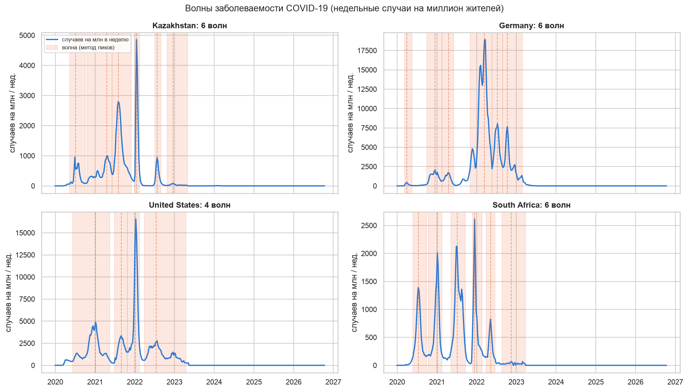
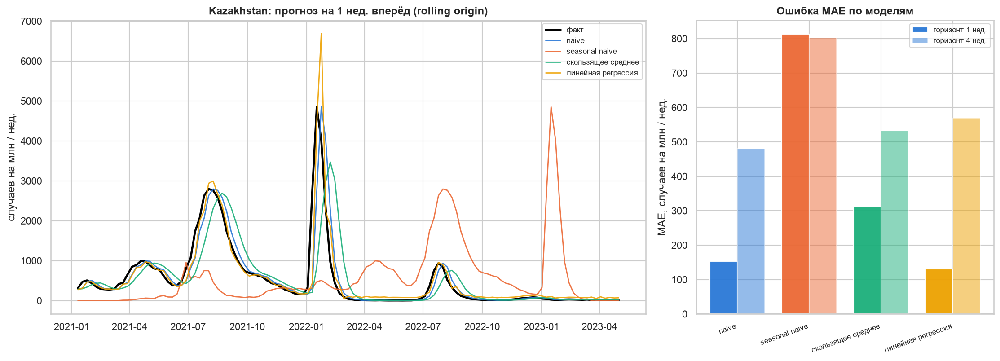
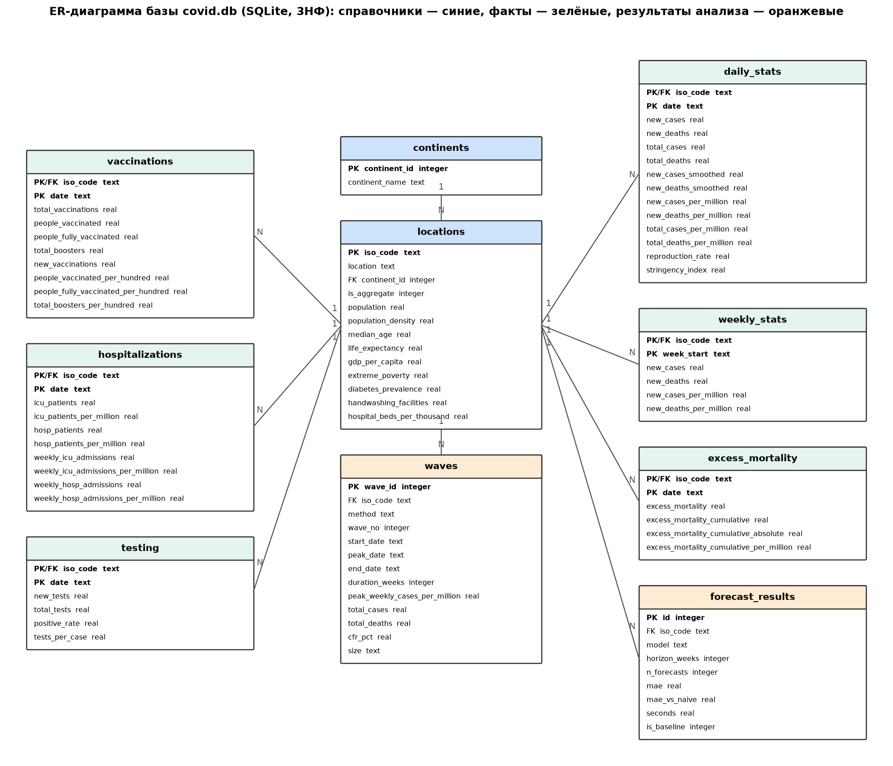
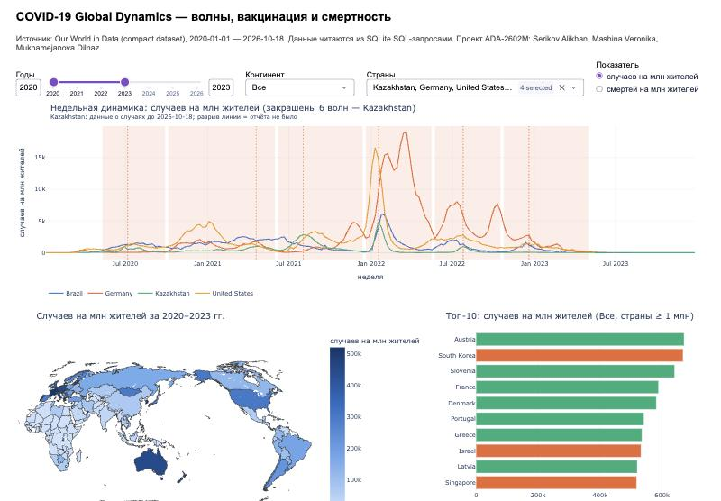

# COVID-19 Global Dynamics

Анализ волн заболеваемости, вакцинации и смертности от COVID-19 по странам мира на данных Our World in Data
(629 868 строк, 2020-01-01 … 2026-10-18). Программа читает большой CSV чанками, проверяет и очищает данные,
строит недельные ряды, находит волны заболеваемости двумя методами, сравнивает четыре модели прогноза с baseline,
считает корреляции, складывает очищенные данные в SQLite с 18 SQL-запросами и показывает результаты
в дашборде Dash. Полный прогон занимает около 20 секунд, все числа сохраняются в `outputs/results.json`.

**Тема 10 «COVID-19 Global Dynamics»** · Cluster 2 «Exploratory Analytics, Time Series & Dashboards» ·
дисциплина «Programming for Data Analysis and Database» · Astana IT University, ОП Applied Data Analytics (магистратура),
группа ADA-2602M · команда: **Serikov Alikhan, Mashina Veronika, Mukhamejanova Dilnaz**.

Код: https://github.com/SalaFanChik/covid-global-dynamics. Письменный отчёт (`docs/report/`) и презентация
(`docs/presentation/`) загружаются также в Moodle за 2–3 дня до итогового экзамена.

## Содержание

1. [Данные](#1-данные)
2. [Быстрый старт](#2-быстрый-старт)
3. [Варианты запуска](#3-варианты-запуска)
4. [Структура репозитория](#4-структура-репозитория)
5. [Шаги пайплайна и их файлы](#5-шаги-пайплайна-и-их-файлы)
6. [Соответствие требованиям](#6-соответствие-требованиям)
7. [Ключевые результаты](#7-ключевые-результаты)
8. [База данных и SQL](#8-база-данных-и-sql)
9. [Дашборд](#9-дашборд)
10. [Ограничения](#10-ограничения)
11. [Команда и вклад](#11-команда-и-вклад)
12. [Источники](#12-источники)

## 1. Данные

Источник — Our World in Data, набор «COVID-19 dataset» (compact-версия).

- Файл: https://catalog.ourworldindata.org/garden/covid/latest/compact/compact.csv → `data/raw/owid_covid_compact.csv`,
  185,3 МБ, 629 868 строк × 61 столбец, период 2020-01-01 … 2026-10-18, md5 `0af7a57f919d603b77986a0f3af7679c`
  (срез, на котором получены все числа в этом README).
- Репозиторий из задания, https://github.com/owid/covid-19-data, не обновляется с 19.08.2024 и в своём README отсылает
  к файлу в каталоге OWID. Столбцы `country`/`code` этого файла при загрузке переименовываются в `location`/`iso_code` —
  имена из кодбука и старого файла `owid-covid-data.csv`. Подробности — в [docs/data_notes.md](docs/data_notes.md).
- Кодбук (описание переменных): [data/raw/owid-covid-codebook.csv](data/raw/owid-covid-codebook.csv).
- Лицензия CC BY 4.0. Цитирование: Mathieu, E., Ritchie, H., Rodés-Guirao, L., Appel, C., Giattino, C., Hasell, J.,
  Macdonald, B., Dattani, S., Beltekian, D., Ortiz-Ospina, E., Roser, M. (2020). «Coronavirus Pandemic (COVID-19)».
  OurWorldinData.org.

Что лежит в репозитории, а что создаётся при запуске:

| Файл | В git | Как появляется |
|---|---|---|
| `data/raw/owid_covid_compact.csv` (185 МБ) | нет | скачивается шагом 1 или `python scripts/download_data.py` |
| `data/raw/owid-covid-codebook.csv` | да | — |
| `data/processed/covid_clean.parquet` (21 МБ) | да | снимок очищенных данных; шаг 1 перезаписывает его; без интернета используется как есть |
| `data/processed/covid_raw_optimized.parquet` (23 МБ) | нет | шаг 1 |
| `data/covid.db` (92 МБ) | нет | шаг 5 |
| `outputs/` — таблицы, графики, `results.json` | да | каждый шаг перезаписывает свои файлы |

Аудит и очистка (`outputs/tables/data_audit.txt`, `cleaning_log.json`, функции `src/cleaning.py`):

- 262 локации, дубликатов ключа (location, date) нет, отрицательных значений нет; проверка `total_cases.diff() == new_cases`
  на дневной отчётности 2020–2022: 254 409 строк, 0 расхождений.
- 65,5 % нулей в `new_cases`: с 2023 г. отчётность недельная, поэтому базовая частота анализа — неделя.
- Удалены: полностью пустой столбец `human_development_index`; 15 сущностей без ISO-кода (26 184 строки: England, Scotland,
  Wales, Northern Ireland, England and Wales, четыре группы стран по доходу, две Олимпиады, три варианта «World excl. …»,
  «Asia excl. China»); 6 локаций без единого отчёта о случаях (5 461 строка: Cote d'Ivoire, Western Sahara, Hong Kong,
  Macao, Transnistria, Taiwan).
- 8 агрегатов OWID (World, Africa, Asia, Europe, European Union (27), North America, Oceania, South America; 19 840 строк)
  помечены `is_aggregate = True`: они нужны для графиков, но не попадают в статистику по странам.
- Пропуски `new_cases` (10 896 строк) и `new_deaths` (9 633 строки) оставлены как NaN — это «отчёта не было»
  (Германия не отчитывается с 2023-07-10, США с 2023-05-21). Нулями они не заполняются, иначе исказились бы ряды и прогноз.
- Отрицательные значения обрезаются до нуля (в этом срезе их 0). Итог: 598 223 строки, 241 локация
  (233 страны + 8 агрегатов), добавлен столбец `year`.

## 2. Быстрый старт

Нужен Python 3.12 (проверено на 3.12.14; версии библиотек закреплены в `requirements.txt`).

```bash
git clone https://github.com/SalaFanChik/covid-global-dynamics.git
cd covid-global-dynamics

# 1. окружение и библиотеки (1–2 мин при первой установке, с кешем pip около 30 с)
python3.12 -m venv .venv && source .venv/bin/activate     # Windows: py -3.12 -m venv .venv && .venv\Scripts\activate
pip install -r requirements.txt

# 2. весь анализ: около 20 с (при первом запуске плюс разовое скачивание 185 МБ)
python main.py --all

# 3. дашборд: http://127.0.0.1:8050 (остановить — Ctrl+C)
python dashboard/app.py
```

Замеры из `outputs/results.json` (MacBook на чипе Apple M-серии, Python 3.12.14): шаги 10,8 / 0,3 / 1,3 / 0,9 / 5,0 / 0,7 с,
всего 19,0 с при уже скачанном файле. Проверка на свежем клоне в день сдачи: установка библиотек около 1,5 мин,
`python main.py --all` 45 с вместе со скачиванием, затем `python scripts/smoke_test.py` — «Все проверки пройдены».
Повторный прогон на свежем клоне дал те же числа строк, волн и метрик; отличаются только времена — на сотые и десятые
доли секунды, поэтому все времена в этом README приведены из одного полного прогона `python main.py --all`
(15.11.2026; раздел `время_шагов_с` в `results.json`).

## 3. Варианты запуска

### 3.1 Консольное меню

`python main.py` (без аргументов) показывает меню:

| Пункт | Что делает |
|---|---|
| 1 | Скачать и подготовить данные (чанки, типы, Parquet, аудит, очистка) |
| 2 | EDA: статистика, пропуски, выбросы |
| 3 | Временные ряды и детекция волн |
| 4 | Прогноз и сравнение с baseline (MAE) |
| 5 | База данных SQLite и SQL-запросы |
| 6 | Корреляции и интерактивные графики |
| 7 | Выполнить все шаги подряд |
| 8 | Запустить дашборд Dash |
| 9 | Показать сохранённые результаты (`results.json`) |
| 0 | Выход |

Каждый пункт сохраняет результаты в файлы, поэтому шаги можно выполнять по отдельности и в разные дни. Пункты 2–6 требуют
очищенных данных из пункта 1 (иначе выводится понятное сообщение `FileNotFoundError` с подсказкой); пункт 5 берёт волны
и метрики прогноза из CSV прошлого запуска или считает их сам; пункт 6 использует базу, если она есть, иначе пропускает
блок «вакцинация vs смертность» с сообщением. Неверный ввод («abc», «12») — сообщение и повтор меню; Ctrl+C или Ctrl+D —
выход без трассировки.

### 3.2 Один шаг из командной строки

`python main.py --step N`, где N — номер пункта меню с действием: 1–8 (1–6 — шаги анализа, 7 — все шаги подряд, 8 — дашборд). Например, `python main.py --step 2` пересчитывает только EDA: сам шаг занимает
около 0,4 с, вместе с запуском Python — около 1,5 с. На номер без действия (`--step 9`, `--step 0`) программа отвечает
«Нет шага с номером 9» и завершается с кодом 1. `python main.py --all` равен пункту 7, но без меню.

### 3.3 Проверка после прогона

```bash
python scripts/smoke_test.py
```

Проверяет, что на месте 13 таблиц, 13 графиков и ER-диаграмма, что в базе 10 ожидаемых таблиц, целы внешние ключи
(`PRAGMA foreign_key_check`), в `daily_stats` больше 500 тыс. строк, волны не пересекаются, Pandas и SQL дали одинаковый
результат и выполнены все 18 SQL-запросов каталога. Ожидаемый вывод — три строки с галочками и «Все проверки пройдены».

### 3.4 Работа без интернета

Если скачивание не удалось (`ConnectionError`: нет сети, таймаут, обрыв), шаг 1 печатает причину («Не удалось скачать
данные: … Использую сохранённый снимок covid_clean.parquet») и берёт снимок очищенных данных
`data/processed/covid_clean.parquet` из репозитория. Шаги 2–6 и дашборд работают полностью; в этом режиме шаг 1
не пересчитывает только то, что требует исходного CSV: сравнение форматов, аудит и журнал очистки (их версии из последнего
прогона уже лежат в `outputs/tables` и в разделе `1_данные` файла `results.json`). Скачать файл отдельно:
`python scripts/download_data.py` (если файл уже есть, скрипт сообщает об этом и ничего не качает).

### 3.5 Дашборд

`python dashboard/app.py` или пункт 8 меню → http://127.0.0.1:8050. Нужна база `data/covid.db` (создаётся шагом 5
или `--all`); без неё программа печатает подсказку и завершается с кодом 1. Если порт 8050 занят, измените `DASH_PORT`
в `config.py` или запустите дашборд на другом порту:

```bash
python -c "from dashboard.app import run_dashboard; run_dashboard(port=8061)"
```

### 3.6 Ноутбук

Ноутбук `notebooks/COVID19_Global_Dynamics.ipynb` повторяет шаги анализа с пояснениями и графиками: он импортирует
модули проекта и вызывает те же функции, что и консольное меню; результаты последнего выполнения сохранены в файле.

- Локально (jupyter входит в `requirements.txt`), из корня проекта с активированным `.venv`:
  `jupyter notebook notebooks/COVID19_Global_Dynamics.ipynb`.
- В Google Colab: откройте
  https://colab.research.google.com/github/SalaFanChik/covid-global-dynamics/blob/main/notebooks/COVID19_Global_Dynamics.ipynb.
  Первая ячейка клонирует репозиторий (`git clone`), переходит в его папку (`%cd`) и выполняет
  `pip install -q -r requirements-colab.txt` — в Colab уже есть pandas, scipy, statsmodels, scikit-learn, matplotlib,
  seaborn и plotly, не хватает только `dash==4.5.0`.

### 3.7 VS Code и PyCharm

- VS Code: откройте папку проекта, выберите интерпретатор `.venv` (команда «Python: Select Interpreter») и запустите `main.py`.
- PyCharm Community Edition: File → Open → папка проекта; Settings → Project → Python Interpreter → Add Existing →
  `.venv/bin/python` (Windows: `.venv\Scripts\python.exe`); правый клик на `main.py` → Run.

### 3.8 Служебные скрипты

- `python scripts/download_data.py` — скачать данные отдельно от пайплайна.
- `python scripts/make_erd.py` — перерисовать `docs/erd.png` по реальной схеме `data/covid.db`.
- `python scripts/smoke_test.py` — проверка результатов (см. 3.3).

## 4. Структура репозитория

```
covid-global-dynamics/
├── main.py                        # консольное меню, --all, --step N; шаги пайплайна и кэш STATE
├── config.py                      # пути (pathlib), URL данных, параметры волн и прогноза, порт дашборда
├── requirements.txt               # библиотеки с версиями (Python 3.12)
├── requirements-colab.txt         # то, чего нет в Google Colab (dash)
├── src/
│   ├── utils.py                   # лог со временем, Timer/MemoryTimer (tracemalloc), JSON/CSV, results.json
│   ├── data_loader.py             # скачивание, чтение CSV чанками, оптимизация типов, Parquet, 5 способов чтения
│   ├── cleaning.py                # аудит качества и очистка с журналом шагов
│   ├── eda.py                     # типы признаков, describe, пропуски, выбросы IQR, сводка по странам
│   ├── timeseries.py              # недельная и месячная таблицы (resample), скользящие средние, декомпозиция
│   ├── waves.py                   # детекция волн: порог (baseline) и find_peaks; сравнение, чувствительность
│   ├── forecasting.py             # naive, seasonal naive, скользящее среднее, LinearRegression; rolling origin; MAE
│   ├── correlation.py             # матрица Спирмена, частная корреляция, вакцинация vs смертность
│   ├── database.py                # схема SQLite (3НФ), загрузка, выполнение запросов, Pandas vs SQL
│   ├── sql_queries.py             # каталог из 18 SQL-запросов (словарь QUERIES)
│   └── visualization.py           # 10 PNG (matplotlib/seaborn) и 3 интерактивных HTML (Plotly)
├── dashboard/app.py               # мини-дашборд Dash с фильтрами; все данные из SQLite
├── scripts/
│   ├── download_data.py           # отдельное скачивание данных
│   ├── make_erd.py                # ER-диаграмма из реальной схемы базы -> docs/erd.png
│   └── smoke_test.py              # проверка результатов после прогона
├── notebooks/
│   └── COVID19_Global_Dynamics.ipynb   # ноутбук с ходом анализа (локально и в Google Colab)
├── data/
│   ├── raw/owid-covid-codebook.csv            # описание переменных OWID (в git)
│   ├── raw/owid_covid_compact.csv             # 185 МБ, скачивается (не в git)
│   ├── processed/covid_clean.parquet          # очищенные данные, 21 МБ (в git — офлайн-режим)
│   ├── processed/covid_raw_optimized.parquet  # создаётся шагом 1 (не в git)
│   └── covid.db                               # SQLite, 92 МБ, создаётся шагом 5 (не в git)
├── outputs/
│   ├── results.json               # все числа последнего прогона по разделам шагов
│   ├── tables/                    # CSV/JSON/TXT: аудит, EDA, волны, прогноз, sql_<запрос>.csv, корреляции
│   └── figures/                   # 10 PNG и 3 HTML
└── docs/
    ├── task_requirements.md       # выписка из требований курса и критерии оценки
    ├── data_notes.md              # заметки о данных: две версии файла, особенности отчётности
    ├── architecture.md            # архитектура: модули и функции, параметры, схема базы, запросы
    ├── erd.png, erd.mmd           # ER-диаграмма (строится scripts/make_erd.py)
    ├── img/                       # скриншоты дашборда
    ├── report/                    # письменный отчёт
    └── presentation/              # презентация к защите
```

## 5. Шаги пайплайна и их файлы

| Шаг | Функция в `main.py` | Что делает | Что записывает |
|---|---|---|---|
| 1 | `step_load_data` | скачивание во временный файл с проверкой размера; `read_csv(chunksize=100 000)` — 7 чанков, приведение типов в каждом; Parquet; сравнение 5 способов чтения; аудит качества; очистка в 7 шагов | `data/raw/owid_covid_compact.csv`, `data/processed/covid_raw_optimized.parquet`, `covid_clean.parquet`; таблицы `format_comparison.csv`, `data_audit.json`, `data_audit.txt`, `cleaning_log.json`, `location_coverage.csv`; раздел `1_данные` в `results.json` |
| 2 | `step_eda` | типы признаков, `describe` по 10 показателям, пропуски, сводка «одна строка на страну», выбросы IQR по континентам | `eda_describe.csv`, `eda_missing.csv`, `country_summary.csv`, `eda_outliers_deaths.csv`, `eda_outliers_summary.csv`; `deaths_boxplot_by_continent.png`; раздел `2_eda` |
| 3 | `step_timeseries_and_waves` | недельная таблица (85 555 строк); 7-дневное скользящее среднее против столбца OWID; декомпозиция дневного ряда США (period 7) и недельного World (period 52); волны двумя методами; сравнение методов, сопоставление пиков, чувствительность, проверка покрытия | `rolling_mean_kazakhstan.csv`, `waves_threshold.csv`, `waves_peaks.csv`, `wave_methods_comparison.csv`, `wave_methods_peak_matching.csv`, `wave_sensitivity.csv`, `wave_coverage_check.csv`; `seasonal_decomposition_us_daily.png`, `weekday_effect.png`, `seasonal_decomposition_world.png`, `waves_small_multiples.png`, `wave_methods_comparison.png`; раздел `3_ряды_и_волны` |
| 4 | `step_forecast` | 4 модели × 2 горизонта на 11 рядах (10 стран + World), rolling origin 2021-01-01 … 2023-04-30 | `forecast_metrics.csv`, `forecast_summary.csv`, `forecast_predictions.csv`, `forecast_mae_by_year.csv`; `forecast_comparison.png`; раздел `4_прогноз` |
| 5 | `step_database` | база SQLite с нуля (10 таблиц), 18 запросов с выгрузкой в pandas, Pandas vs SQL, два графика по результатам запросов | `data/covid.db`; `sql_queries_summary.csv`, 18 файлов `sql_<запрос>.csv`, `pandas_vs_sql.csv`; `top15_deaths_per_million.png`, `cfr_by_wave_year.png`; раздел `5_база_и_sql` |
| 6 | `step_correlation_and_interactive` | матрица Спирмена по 158 странам, вакцинация vs смертность 2022 г. (данные запроса `vaccination_vs_deaths_2022`), три интерактивных графика Plotly | `correlation_matrix.csv`, `vaccination_vs_deaths_by_age_group.csv`; `correlation_heatmap.png`, `interactive_weekly_cases.html`, `interactive_map_monthly_cases.html`, `interactive_vaccination_vs_deaths.html`; раздел `6_корреляции` |
| 7 | `run_all` | шаги 1–6 подряд с замером времени | разделы `время_шагов_с` и `среда` (версии библиотек, платформа, md5 файла) |

## 6. Соответствие требованиям

### 6.1 Технические требования 1–11

| № | Требование | Где реализовано (файл: функция) |
|---|---|---|
| 1 | Функции (не менее 5) | 140 функций `def` во всех модулях, например `src/data_loader.py: read_csv_in_chunks, optimize_types, compare_read_methods`; `src/waves.py: detect_waves_peaks, compare_methods`; `src/forecasting.py: rolling_origin_evaluation`; `main.py: step_load_data … step_correlation_and_interactive` |
| 2 | list и dict | журнал очистки — список словарей (`src/cleaning.py: clean_data` → `cleaning_log.json`); каталог запросов `src/sql_queries.py: QUERIES`; `main.py: MENU, PIPELINE_STEPS, STATE`; `src/forecasting.py: MODELS`; `dashboard/app.py: METRICS`; `config.py: FOCUS_COUNTRIES, REFERENCE_PEAKS`; итоги по странам в словаре (`src/data_loader.py: stream_country_totals`) |
| 3 | if / elif / else | выбор пункта меню (`main.py: run_menu`); размер волны (`src/waves.py: classify_wave`); возрастные группы стран (`src/correlation.py: vaccination_vs_mortality`); вывод по моделям (`src/forecasting.py: conclusion`); сторона связи на ER-диаграмме (`scripts/make_erd.py: connect_boxes`) |
| 4 | Циклы | `for` по чанкам CSV (`src/data_loader.py: read_csv_in_chunks`), по странам (`src/waves.py: detect_waves_for_all`), по точкам rolling origin и моделям (`src/forecasting.py: rolling_origin_evaluation`), по запросам (`src/database.py: run_queries`); `while True` в меню (`main.py: run_menu`); `while` для границ волн (`src/waves.py: detect_waves_peaks`) |
| 5 | Файлы | чтение CSV (`src/data_loader.py: read_csv_in_chunks`), запись CSV (`src/utils.py: save_table`), Parquet (`src/data_loader.py: save_parquet, load_parquet`), JSON (`src/utils.py: save_json, load_json, update_results`), TXT (`src/cleaning.py: write_audit_txt` → `outputs/tables/data_audit.txt`), PNG и HTML (`src/visualization.py: save_figure, save_html`), SQLite (`src/database.py: build_database`) |
| 6 | try / except | нет интернета — `ConnectionError` (`src/data_loader.py: download_dataset`) и переход на снимок данных (`main.py: step_load_data`); нет файла — `FileNotFoundError` (`src/data_loader.py: load_parquet`, `main.py: run_menu`); неверный ввод, Ctrl+C и Ctrl+D (`main.py: run_menu`); ошибка в SQL — `sqlite3.Error` (`src/database.py: run_queries`, `dashboard/app.py: update_figures`); занятый порт — `OSError` (`dashboard/app.py: run_dashboard`); нет pyarrow — `ImportError` (`src/data_loader.py`); неизвестная страна — `ValueError` (`src/forecasting.py: evaluate_locations`) |
| 7 | Пользовательский интерфейс | консольное меню 0–9 (`main.py: run_menu`) и дашборд Dash с четырьмя фильтрами (`dashboard/app.py: build_app`) |
| 8 | Модульность | `config.py` + 11 модулей `src/` + `dashboard/app.py` + 4 скрипта; стандартная библиотека: `pathlib`, `datetime`, `json`, `sqlite3`, `time`, `tracemalloc`, `hashlib`, `urllib`, `shutil`, `argparse`, `platform`, `math`, `sys` |
| 9 | Обоснование подхода | 5 способов чтения данных по времени, итоговой и пиковой памяти (`src/data_loader.py: compare_read_methods`); Pandas vs SQL на одной и той же агрегации (`src/database.py: compare_pandas_vs_sql`); два метода волн против эталонных пиков и таблица чувствительности (`src/waves.py: compare_methods, reference_recall, sensitivity_table`); 4 модели прогноза против naive по MAE и времени (`src/forecasting.py: summarize_models`); числа — в разделе 7 |
| 10 | БД и SQL | SQLite, 10 таблиц в 3НФ с внешними ключами и 4 индексами (`src/database.py: SCHEMA_SQL, build_database`); ER-диаграмма из реальной схемы (`scripts/make_erd.py` → `docs/erd.png`); 18 запросов с JOIN, GROUP BY/HAVING, подзапросами, CTE и оконными функциями (`src/sql_queries.py: QUERIES`); результаты выгружаются в pandas (`src/database.py: run_queries`) и используются в графиках (`src/visualization.py: plot_top_deaths, plot_cfr_by_wave_year, plotly_vaccination_scatter`), в корреляциях (`src/correlation.py: vaccination_vs_mortality`) и в дашборде |
| 11 | Объём данных | 629 868 строк × 61 столбец, 185,3 МБ: `read_csv(chunksize=100_000)` — 7 чанков; типы float64 → float32 и текст → category: 326,3 → 184,6 МБ (−43,4 %); Parquet 22,7 МБ читается за 0,019 с; потоковая агрегация по чанкам — пик памяти 4,5 МБ (`src/data_loader.py`) |

### 6.2 Обязательные задачи кластера 2

| Задача | Где реализовано | Результат |
|---|---|---|
| EDA: описательная статистика, пропуски, выбросы (IQR/boxplot), типы признаков | `src/eda.py: feature_types, describe_numeric, missing_report, iqr_bounds, detect_outliers_iqr, country_summary`; `src/visualization.py: plot_deaths_boxplot` | типы: 57 числовых, 3 категориальных, 1 дата, 1 логический; 57 столбцов с пропусками; 15 стран-выбросов по смертности на млн внутри континентов (Peru, Georgia, Armenia, Guam, Tunisia, …); `eda_*.csv`, `country_summary.csv`, `deaths_boxplot_by_continent.png` |
| Временные ряды: resample, скользящие средние, сезонная декомпозиция | `src/timeseries.py: make_weekly_table` (недели пн–вс через `pd.Grouper(freq="W-SUN")`), `resample_series`, `rolling_mean`, `decompose_series` (`statsmodels.seasonal_decompose`), `weekday_effect`, `seasonality_strength` | наше 7-дневное среднее совпадает со столбцом `new_cases_smoothed` OWID (`rolling_mean_kazakhstan.csv`); эффект дня недели в США: пн −30,6 %, вт −37,5 %, пт +32,4 % (`weekday_effect.png`); сила годовой сезонности World 0,628 при 3,9 циклах — только описательно (`seasonal_decomposition_world.png`) |
| Корреляционный анализ (corr, heatmap) | `src/correlation.py: correlation_matrix` (Спирмен), `strongest_correlations`, `partial_correlation`, `vaccination_vs_mortality`; `src/visualization.py: plot_correlation_heatmap` | `correlation_matrix.csv`, `correlation_heatmap.png`, `vaccination_vs_deaths_by_age_group.csv`; числа — в 7.4 |
| 4–5 визуализаций, не менее 1 интерактивной (Plotly) | `src/visualization.py`: 10 PNG и 3 интерактивных HTML (`plotly_weekly_lines`, `plotly_choropleth`, `plotly_vaccination_scatter`); графики дашборда тоже Plotly | `outputs/figures/` |
| Хранение очищенных данных в SQLite, выборки через SQL | `src/database.py: build_database, run_queries`; `src/sql_queries.py: QUERIES` | `data/covid.db` (10 таблиц), 18 файлов `sql_<запрос>.csv`, `sql_queries_summary.csv` |
| Мини-дашборд Streamlit/Dash с фильтрами (год, регион, категория) | `dashboard/app.py: build_app` — годы (RangeSlider), континент (Dropdown), страны (multi Dropdown), показатель (RadioItems); данные из SQLite параметризованными запросами | http://127.0.0.1:8050; скриншоты в `docs/img/` |
| Сравнение простого прогноза с baseline (MAE) | `src/forecasting.py`: naive и seasonal naive (baseline) против скользящего среднего и LinearRegression на 4 лагах; rolling origin 2021-01-01 … 2023-04-30 без утечки данных; горизонты 1 и 4 недели | `forecast_summary.csv`, `forecast_metrics.csv`, `forecast_comparison.png`; числа — в 7.3 |

## 7. Ключевые результаты

### 7.1 Загрузка: форматы и память

Пять способов прочитать одни и те же данные (`outputs/tables/format_comparison.csv`; время — лучшее из двух запусков,
пиковая память — `tracemalloc`):

| Способ | Файл, МБ | Время, с | Память DataFrame, МБ | Пик памяти, МБ |
|---|---:|---:|---:|---:|
| CSV как есть (float64, строки) | 185,3 | 0,361 | 326,2 | 388,7 |
| CSV + оптимизация типов | 185,3 | 0,763 | 184,6 | 388,7 |
| CSV чанками + оптимизация типов | 185,3 | 2,306 | 184,6 | 378,2 |
| CSV чанками, потоковые итоги по странам | 185,3 | 0,172 | 0,0 | 4,5 |
| Parquet (float32, category) | 22,7 | 0,019 | 184,6 | не измеряется (память выделяет Arrow) |

Вывод: оптимизация типов экономит 43,4 % памяти; чанки сами по себе не уменьшают пик, если все куски нужны для анализа,
но позволяют потоковую обработку с пиком 4,5 МБ; Parquet в 8 раз меньше CSV и читается за сотые доли секунды, поэтому
шаги 2–6 работают с Parquet, а не с CSV.

### 7.2 Волны заболеваемости

Ряд — недельные новые случаи на миллион жителей, сглаженные центрированным средним за 3 недели (`src/waves.py`).

- Baseline «порог»: волна — отрезок не короче 4 недель, где ряд выше медианы ненулевых недельных значений страны
  за 2020-03 … 2023-06; разрывы до 2 недель склеиваются.
- «Пики»: `scipy.signal.find_peaks` на `log1p` ряда с prominence ≥ ln 2 = 0,693 (заболеваемость как минимум удваивается
  до пика и падает вдвое после), расстояние между пиками ≥ 8 недель, пик ≥ 50 на миллион в неделю. Границы между соседними
  пиками — впадина между ними, внешние границы — где ряд опускается ниже 10 % пика, поэтому волны не пересекаются
  (`wave_coverage_check.csv`: доля случаев внутри волн не превышает 1,0). Смерти волны считаются со сдвигом 2 недели, по ним — CFR.

По всем локациям метод пиков нашёл 1 429 волн в 225 странах, порог — 816 волн в 229. Сравнение на странах с населением
не меньше 1 млн (`wave_methods_comparison.csv`); эталон — месяцы известных пиков в Kazakhstan, South Africa, Germany,
United States и India (`config.REFERENCE_PEAKS`, по публикациям ВОЗ/OWID), совпадение ± 4 недели:

| Метод | Волн | Стран | Найдено эталонных пиков | Волн на страну | Медиана длительности | Волн длиннее года | Время |
|---|---:|---:|---:|---:|---:|---:|---:|
| порог (baseline) | 581 | 156 | 73,7 % | 3,72 | 15 нед. | 8,8 % | 0,154 с |
| пики (find_peaks) | 835 | 151 | 100 % | 5,53 | 25 нед. | 5,9 % | 0,158 с |

Пики двух методов совпадают (± 4 недели) с медианным индексом Жаккара 0,5; у 57,1 % стран он не ниже 0,5. Метод пиков
находит все эталонные пики, реже выдаёт неправдоподобные «волны» длиннее года и работает столько же времени, поэтому
он основной: его волны идут в базу, дашборд и SQL-запросы. Чувствительность к главному параметру (`wave_sensitivity.csv`):
при prominence ln 2 × {1; 1,5; 2; 3} у Казахстана 6 / 5 / 5 / 4 волны, у США 4 / 3 / 3 / 2.

Казахстан, метод пиков (`waves_peaks.csv`):

| № | Начало | Пик | Конец | Недель | Пик, случаев на млн/нед. | CFR, % | Размер |
|---:|---|---|---|---:|---:|---:|---|
| 1 | 2020-05-11 | 2020-07-06 | 2020-09-28 | 21 | 703,4 | 1,54 | малая |
| 2 | 2020-10-05 | 2021-04-19 | 2021-05-31 | 35 | 959,8 | 1,77 | малая |
| 3 | 2021-06-07 | 2021-08-02 (Delta) | 2021-12-13 | 28 | 2 729,8 | 1,73 | средняя |
| 4 | 2021-12-20 | 2022-01-17 (Omicron) | 2022-05-16 | 22 | 3 870,6 | 0,24 | средняя |
| 5 | 2022-05-23 | 2022-07-25 | 2022-10-17 | 22 | 842,2 | 0,04 | малая |
| 6 | 2022-10-24 | 2022-12-19 | 2023-05-01 | 28 | 76,9 | 0,11 | малая |

Летальность волн падала от года к году (SQL-запрос `cfr_by_wave_year`, страны ≥ 1 млн): средний CFR волн с пиком
в 2020 г. — 3,01 %, в 2021 г. — 1,81 %, в 2022 г. — 0,60 %; после 2023 г. волн мало (95, 40, 19 и 2).



### 7.3 Прогноз против baseline

Недельные случаи на миллион для 10 стран и World (11 рядов); оценка «скользящим началом» на 121 неделе с 2021-01-01
по 2023-04-30: модель видит данные только до момента прогноза и прогнозирует на 1 и 4 недели вперёд (`forecast_summary.csv`;
MAE — средний по 11 рядам, «к naive» — среднее отношение MAE модели к MAE naive, «побед» — в скольких рядах модель лучшая):

| Модель | MAE, h = 1 | К naive | Побед | MAE, h = 4 | К naive | Побед |
|---|---:|---:|---:|---:|---:|---:|
| naive (baseline) | 339,8 | 1,00 | 3 | **1 050,4** | 1,00 | **9** |
| seasonal naive, 52 нед. (baseline) | 1 931,6 | 5,38 | 0 | 1 925,1 | 1,74 | 0 |
| скользящее среднее, 4 нед. | 690,9 | 2,03 | 0 | 1 196,3 | 1,15 | 0 |
| линейная регрессия на 4 лагах | **301,9** | **0,895** | **8** | 1 180,5 | 1,15 | 2 |

Вывод: простая регрессия на лагах помогает только на неделю вперёд (на 10 % лучше naive, лучшая в 8 рядах из 11);
на месяц вперёд ничего не обходит naive; seasonal naive проигрывает в разы, потому что у пандемии нет устойчивой
годовой сезонности (пики приходятся на разные месяцы). Ошибка определяется годом Омикрона: MAE naive на неделю вперёд
по годам целевой недели, в среднем по 11 рядам, — 209 (2021), 544 (2022), 121 (2023) случая на млн
(по таблице `forecast_mae_by_year.csv`).



### 7.4 Корреляции

Спирмен по 158 странам с населением не меньше 1 млн (`correlation_matrix.csv`, `correlation_heatmap.png`). Сильнейшие связи
накопленной смертности на миллион: случаев на миллион 0,85; медианный возраст 0,79; тестов на 1 000 жителей 0,76
(полнота учёта); ВВП на душу 0,70; ожидаемая продолжительность жизни 0,67; крайняя бедность −0,65. Учтённая смертность
выше там, где население старше и где больше тестируют, — это связь с регистрацией, а не только с тяжестью эпидемии.

Вакцинация (полностью вакцинированных к концу 2021 г., %) и смертность на миллион в 2022 г. (SQL-запрос
`vaccination_vs_deaths_2022`, `vaccination_vs_deaths_by_age_group.csv`):

| Срез | Стран | Спирмен |
|---|---:|---:|
| все страны | 153 | +0,663 |
| частная корреляция при контроле медианного возраста | 153 | −0,248 |
| медианный возраст < 25 лет | 61 | +0,566 |
| 25–35 лет | 42 | +0,074 |
| 35 лет и старше | 50 | −0,202 |

Это парадокс Симпсона: богатые «старые» страны одновременно лучше привиты и теряют больше пожилых, поэтому общая связь
положительная, а внутри возрастных групп она исчезает или меняет знак. Связь вакцинации с избыточной смертностью
(более честная мера потерь) отрицательная: −0,31 по 89 странам. Летальность зависит от тестирования (запрос `tests_vs_cfr`):
в странах с менее чем 200 тестами на 1 000 жителей CFR 3,11 %, при 200–1 000 — 1,37 %, при 1 000–3 000 — 0,86 %,
свыше 3 000 — 0,41 %. Все эти корреляции межстрановые (экологические) и причинность не доказывают.

### 7.5 Pandas против SQL

Одна и та же агрегация — недельные суммы случаев и смертей по всем локациям из дневных данных (85 555 строк результата),
медиана трёх запусков (`pandas_vs_sql.csv`): pandas `groupby` в памяти — 0,016 с, SQLite `GROUP BY` с выгрузкой
в DataFrame — 0,402 с; результаты совпадают (максимальное расхождение 0,0). Вывод по ролям: pandas — для расчётов
в памяти, SQLite — чтобы хранить очищенные данные между запусками, фильтровать их запросами и обслуживать дашборд
без загрузки CSV.

## 8. База данных и SQL

`data/covid.db` — SQLite, 10 таблиц в третьей нормальной форме, 91,9 МБ, собирается за 2,75 с (`src/database.py`).
Внешние ключи включены (`PRAGMA foreign_keys = ON`), `foreign_key_check` пуст; 4 индекса
(`idx_daily_date`, `idx_weekly_week`, `idx_waves_iso`, `idx_locations_continent`). Схема читается скриптом
`scripts/make_erd.py` прямо из базы, поэтому диаграмма всегда совпадает с кодом.



| Таблица | Строк | Содержимое |
|---|---:|---|
| `continents` | 6 | справочник континентов |
| `locations` | 241 | страны и агрегаты: континент, `is_aggregate`, население, 8 постоянных признаков, даты первого и последнего отчёта |
| `daily_stats` | 598 223 | дневные случаи, смерти, накопленные значения, на миллион, `reproduction_rate`, `stringency_index` |
| `weekly_stats` | 85 555 | недельная витрина, создаётся SQL-запросом из `daily_stats` за 0,35 с и сверена с pandas |
| `vaccinations` | 76 748 | только строки с данными о вакцинации |
| `hospitalizations` | 41 543 | стационар и реанимация |
| `testing` | 104 052 | тесты, доля положительных |
| `excess_mortality` | 13 748 | избыточная смертность |
| `waves` | 2 245 | волны обоих методов (1 429 «пики» + 816 «порог») |
| `forecast_results` | 88 | MAE моделей по странам и горизонтам |

18 запросов каталога `src/sql_queries.py` (имена, конструкции, число строк и время — в `outputs/tables/sql_queries_summary.csv`,
результаты — в `sql_<запрос>.csv`):

| № | Запрос | Что показывает | Конструкции |
|---:|---|---|---|
| 1 | `top15_deaths_per_million` | топ-15 стран (≥ 1 млн) по накопленной смертности на миллион | JOIN 3 таблиц, коррелированный подзапрос |
| 2 | `cases_by_continent_year` | случаи, смерти и летальность по континентам и годам | JOIN, GROUP BY, HAVING, strftime |
| 3 | `world_monthly_change` | месячная динамика случаев в мире и изменение к прошлому месяцу | CTE, оконная функция LAG |
| 4 | `rank_within_continent` | три страны с наибольшей смертностью внутри каждого континента | CTE, JOIN, RANK … PARTITION BY |
| 5 | `rolling_average_kazakhstan` | 7-дневное скользящее среднее в SQL против столбца OWID | оконная функция AVG … ROWS BETWEEN |
| 6 | `vaccination_vs_deaths_2022` | вакцинация к концу 2021 г. и смертность 2022 г. (страны > 1 млн) | 2 CTE, JOIN 4 таблиц, агрегаты |
| 7 | `waves_per_country` | число волн по странам и самая сильная волна каждой | CTE, ROW_NUMBER и COUNT … OVER, JOIN |
| 8 | `waves_by_continent` | волн на страну, длительность и летальность по континентам | JOIN, GROUP BY, HAVING, COUNT DISTINCT |
| 9 | `cfr_by_wave_year` | летальность волн по году пика | GROUP BY, strftime, агрегаты |
| 10 | `countries_above_world_peak` | страны, чей пик втрое выше мирового | JOIN, GROUP BY, HAVING со скалярным подзапросом |
| 11 | `excess_vs_reported` | избыточная смертность против официальной | CTE, JOIN 4 таблиц, NULLIF |
| 12 | `icu_peaks` | пиковая загрузка реанимаций по странам | CTE, ROW_NUMBER, JOIN |
| 13 | `weekly_cases_by_continent` | недельные случаи по континентам (тот же расчёт — в pandas) | JOIN, GROUP BY |
| 14 | `forecast_best_models` | лучшая модель прогноза для каждой страны и горизонта | подзапрос, RANK, JOIN |
| 15 | `vaccination_tiers` | группы стран по уровню вакцинации: смертность 2022 г., возраст, ВВП | CASE WHEN, CTE, GROUP BY, LEFT JOIN |
| 16 | `countries_without_vaccination_data` | страны с данными о случаях, но без записей о вакцинации | NOT EXISTS, JOIN |
| 17 | `running_total_check` | накопительная сумма `new_cases` против `total_cases` OWID (Казахстан) | SUM … OVER (ORDER BY), подзапрос |
| 18 | `tests_vs_cfr` | тестирование и наблюдаемая летальность по группам стран | 2 CTE, JOIN 3 таблиц, коррелированный подзапрос, CASE WHEN, GROUP BY |

Результаты запросов не лежат мёртвым грузом: `top15_deaths_per_million` и `cfr_by_wave_year` рисуются в
`top15_deaths_per_million.png` и `cfr_by_wave_year.png`, `vaccination_vs_deaths_2022` идёт в корреляционный анализ,
интерактивный график и дашборд, `running_total_check` подтверждает согласованность данных (разность 0 на всех контрольных датах).

## 9. Дашборд

`python dashboard/app.py` → http://127.0.0.1:8050 (Dash 4.5). Все данные дашборд берёт параметризованными SQL-запросами
из `data/covid.db` и стартует за секунды, не трогая CSV.



Фильтры:

- **Годы** — `RangeSlider` 2020–2026 (по умолчанию 2020–2023);
- **Континент** — `Dropdown` («Все» или один из шести);
- **Страны** — `Dropdown` с множественным выбором; список стран зависит от выбранного континента;
- **Показатель** — `RadioItems`: случаев или смертей на миллион жителей.

Графики: недельные ряды выбранных стран с закрашенными волнами первой из них (в подзаголовке — дата последнего отчёта
страны, разрыв линии означает отсутствие отчёта); карта-хороплет суммы показателя за выбранные годы; топ-10 стран;
вакцинация к концу 2021 г. против смертности 2022 г. (фильтруется по континенту); таблица волн первой выбранной страны.
Нижняя часть страницы — [docs/img/dashboard_bottom.jpg](docs/img/dashboard_bottom.jpg). Ошибки обрабатываются:
нет базы — подсказка выполнить шаг 5, ошибка SQLite — сообщение внутри графиков, занятый порт — сообщение вместо трассировки.

## 10. Ограничения

- С 2023 г. отчётность недельная и нерегулярная, после 2023 г. ряды большинства стран состоят из нулей и пропусков
  (мировые случаи по годам: 2022 — 444 млн, 2023 — 44 млн, 2024 — 3,5 млн, 2025 — 1,7 млн; `docs/data_notes.md`).
  Поэтому базовая частота — неделя, порог baseline-метода считается на окне 2020-03 … 2023-06, прогноз оценивается
  на 2021-01 … 2023-04, графики волн обрезаны 2024 годом.
- Данные о вакцинации заканчиваются в 2023–2024 гг. (Казахстан — 2023-04-30, Германия — 2023-12-23, США — 2023-05-09,
  World — 2024-08-12); бустеры и поздние кампании не отражены.
- Госпитализации есть только у 6,5 % строк, тесты — у 16,8 %, избыточная смертность — у 2,2 %, поэтому запросы и
  корреляции по этим блокам охватывают часть стран (например, избыточная смертность — 89 стран).
- Все корреляции межстрановые (экологические): они описывают различия между странами, а не влияние на отдельного человека,
  и причинность не доказывают; пример — парадокс Симпсона в связи вакцинации и смертности.
- CFR зависит от объёма тестирования и полноты регистрации смертей (раздел 7.4); учтённые случаи занижены сильнее
  в бедных странах, что влияет и на высоту волн «на миллион».
- Детекция волн зависит от параметров (таблица чувствительности) и от качества отчётности; эталонные пики есть только
  для 5 стран, поэтому метрика «найдено эталонных пиков» ориентировочная.
- Прогноз оценён на 11 рядах простыми моделями; MAE измеряется в случаях на миллион и определяется в основном
  волной Омикрона 2022 г.
- Время выполнения измерено на одной машине (macOS, Apple M-серия, Python 3.12.14); на других компьютерах числа будут
  другими. Файл в каталоге OWID может обновиться: при повторном скачивании строки после 2026-10-18 добавятся
  и числа слегка изменятся (контроль — md5 в `results.json`).

## 11. Команда и вклад

| Участник | Модули и материалы | Проверял(а) |
|---|---|---|
| Serikov Alikhan | `config.py`, `main.py`, `src/data_loader.py`, `src/cleaning.py`, `src/database.py` + `src/sql_queries.py` + `scripts/make_erd.py`, `src/waves.py`, `README.md` | Mashina Veronika |
| Mashina Veronika | `src/eda.py`, `src/timeseries.py`, `src/correlation.py`, `src/visualization.py`, письменный отчёт | Mukhamejanova Dilnaz |
| Mukhamejanova Dilnaz | `src/forecasting.py`, `dashboard/app.py`, `scripts/smoke_test.py`, ноутбук, презентация | Serikov Alikhan |

Это рабочее разделение: каждый модуль писал один участник и проверял другой, и каждый участник отвечает на вопросы
по любой части кода.

## 12. Источники

1. Mathieu, E., Ritchie, H., Rodés-Guirao, L., Appel, C., Giattino, C., Hasell, J., Macdonald, B., Dattani, S.,
   Beltekian, D., Ortiz-Ospina, E., Roser, M. (2020). «Coronavirus Pandemic (COVID-19)». OurWorldinData.org —
   https://ourworldindata.org/coronavirus (лицензия CC BY 4.0, https://creativecommons.org/licenses/by/4.0/).
2. Файл данных: https://catalog.ourworldindata.org/garden/covid/latest/compact/compact.csv;
   репозиторий https://github.com/owid/covid-19-data (заморожен 19.08.2024), кодбук `public/data/owid-covid-codebook.csv`.
3. Hyndman, R. J., Athanasopoulos, G. Forecasting: Principles and Practice (3rd ed.) — naive и seasonal naive как baseline,
   сила сезонности, оценка со скользящим началом. https://otexts.com/fpp3/
4. Документация библиотек: pandas (https://pandas.pydata.org/docs/), SciPy `find_peaks`
   (https://docs.scipy.org/doc/scipy/reference/generated/scipy.signal.find_peaks.html), statsmodels `seasonal_decompose`
   (https://www.statsmodels.org/), scikit-learn `LinearRegression` (https://scikit-learn.org/), Plotly (https://plotly.com/python/),
   Dash (https://dash.plotly.com/), SQLite (https://www.sqlite.org/docs.html).
5. Требования к проекту и критерии оценки — [docs/task_requirements.md](docs/task_requirements.md);
   архитектура кода — [docs/architecture.md](docs/architecture.md); заметки о данных — [docs/data_notes.md](docs/data_notes.md).
